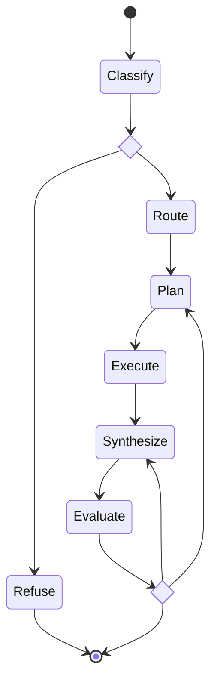

# Serka
Serka (serĉi ekologio) is a prototype search tool for the UKCEH NCUK project. It uses modern AI techniques (LLMs, RAG, knowledge graphs) to enhance the EIDC catalogue's search functionality.

It is built with [FastAPI](https://fastapi.tiangolo.com/), [Neo4j](https://neo4j.com/), [Haystack](https://haystack.deepset.ai/), and [Pydantic AI](https://ai.pydantic.dev/), using Amazon Bedrock for LLM and embedding models.

## AWS Deployment
For AWS deployment instructions see [`terraform/README.md`](terraform/README.md).

## Running with Docker

Ensure you have [Docker](https://docs.docker.com/get-docker/) with the [Compose plugin](https://docs.docker.com/compose/install/) installed.

Copy `.env.example` to `.env` and fill in the required values (username must be `neo4j` but password can be set to whatever you choose):
```
NEO4J_USERNAME=neo4j
NEO4J_PASSWORD=<your password>
```

Start all services:
```
docker compose up -d
```

Stop all services:
```
docker compose down
```

## Ingest Data

Data is ingested from the EIDC catalogue and optionally the Legilo API. To connect to Legilo, ensure your `.env` contains your Legilo personal access token:
```
LEGILO_PAT=yourtoken
```

After starting all services run the ingestion pipeline:
```bash
uv run scripts/ingest-data.py <n>
```

Where `<n>` is the number of EIDC records to ingest. Ingesting all records (2,000+) can take several hours — use a small number (default: 10) for testing.

To ingest specific datasets instead, pass a file of EIDC IDs (one per line): `uv run scripts/ingest-data.py --ids-file tests/smoke/datasets.txt`.

## Chat Pipeline

`POST /v1/chat/stream` and `/v1/chat/stream/agui` run a [pydantic-graph](https://ai.pydantic.dev/graph/) state machine (`src/serka/chat/pipeline.py`) and stream its progress as [AG-UI](https://docs.ag-ui.com/) events. Each node is a `BaseNode` whose `run()` return type defines its edges:



- **Classify**: refuses out-of-scope queries; labels the rest `keyword` (find datasets) or `insight` (needs reasoning).
- **Route**: allows 1 attempt for `keyword`, 3 for `insight`.
- **Plan → Execute**: `keyword` runs a planned `search` directly; `insight` lets a model call MCP tools to follow a plan.
- **Synthesize → Evaluate**: writes a cited answer, then scores it. A failed check retries from Plan (`data` problem) or Synthesize (`writing` problem) while attempts remain; otherwise the best draft is returned, flagged as possibly incomplete.

## Smoke Test

`uv run scripts/smoke-test.py` runs an end-to-end check. It starts a throwaway Neo4j container on port 17687 and ingests the 10 datasets in `tests/smoke/datasets.txt`. It then starts the MCP server (port 8000) and API (port 19000), runs some search and chat queries, and tears everything down. It needs Docker and AWS credentials for Bedrock.

## Contributing

See [CONTRIBUTING.md](CONTRIBUTING.md) for development setup, commit guidelines, and release process.
