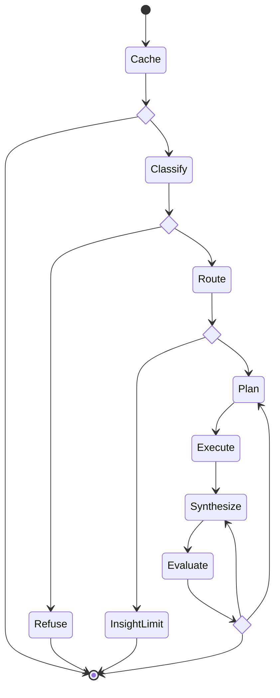

# Serka
Serka (serĉi ekologio) is a prototype search tool for the UKCEH NCUK project. It uses modern AI techniques (LLMs, RAG, hybrid search) to enhance the EIDC catalogue's search functionality.

It is built with [FastAPI](https://fastapi.tiangolo.com/), [Redis](https://redis.io/) (full-text and vector search), [Haystack](https://haystack.deepset.ai/), and [Pydantic AI](https://ai.pydantic.dev/), using Amazon Bedrock for LLM and embedding models. The catalogue is kept as an Open Knowledge Format (OKF) bundle of linked markdown files, which Redis indexes.

## AWS Deployment
For AWS deployment instructions see [`terraform/README.md`](terraform/README.md).

## Running with Docker

Ensure you have [Docker](https://docs.docker.com/get-docker/) with the [Compose plugin](https://docs.docker.com/compose/install/) installed.

Copy `.env.example` to `.env` and fill in the required values, such as `LEGILO_PAT`. `REDIS_URL` defaults to `redis://localhost:6379`, the Redis that `compose.yaml` publishes; the `serka` and `mcp` containers are pointed at the `redis` service. Redis data lives in the `redis-data` volume, or in `REDIS_DATA_DIR` when set. It can always be rebuilt from the bundle with `scripts/load-bundle.py`.

Start all services:
```
docker compose up -d
```

Stop all services:
```
docker compose down
```

## Ingest Data

Data is ingested from the EIDC catalogue and optionally the Legilo API. To connect to Legilo, ensure your `.env` contains your Legilo personal access token:
```
LEGILO_PAT=yourtoken
```

Ingest writes the catalogue as an Open Knowledge Format (OKF) v0.2 bundle: plain markdown files, one per dataset, person, organisation, grant, theme and supporting document, linked to each other, plus `ontology/` files that explain the types, contributor roles and relations used. The bundle is written to `OKF_BUNDLE_DIR` (default `./bundle`, git-ignored). By default the bundle is then loaded into Redis for search.

After starting Redis run the ingestion pipeline:
```bash
uv run scripts/ingest-data.py <n>
```

Where `<n>` is the number of EIDC records to ingest. Ingesting all records (2,000+) can take several hours — use a small number (default: 10) for testing.

To ingest specific datasets instead, pass a file of EIDC IDs (one per line): `uv run scripts/ingest-data.py --ids-file tests/smoke/datasets.txt`.

**Each run replaces the whole bundle.** Ingesting a subset (a small `<n>` or `--ids-file`) leaves only that subset in the bundle and, once loaded, in search. Re-ingesting is cheap because HTTP responses and embeddings are cached under `.cache/`.

Pass `--no-load` to write the bundle without loading it into Redis.

### Load the search index

Redis holds the search index, built from the bundle alone. To rebuild it from an existing bundle (for example after `--no-load`, or after editing bundle files), run:
```bash
uv run scripts/load-bundle.py
```

Loading needs only Redis (`REDIS_URL`) and the Bedrock embedding model, not EIDC or Legilo. It splits every concept file into overlapping 150-word chunks, embeds them (embeddings are cached by content under `.cache/embeddings`, so an unchanged bundle makes no Bedrock calls), then drops and rebuilds the `idx:chunks` and `idx:relations` indexes and the stored concepts. Search is empty or partial while a load runs. Every load also clears the answer cache.

To load a bundle kept somewhere else, such as a test sample, set `OKF_BUNDLE_DIR` for the run:
```bash
OKF_BUNDLE_DIR=~/serka-test-data/random-100/bundle uv run scripts/load-bundle.py
```

The compose `redis` service keeps its data in the `redis-data` volume (or `REDIS_DATA_DIR`), saving RDB snapshots and again on shutdown, so the index survives `docker compose down` and restarts. Load again only when the bundle or the loader changes. `docker compose down -v` deletes the volume.

## Chat Pipeline

`POST /v1/chat/stream` (and `/v1/chat/stream/agui`, when chat is enabled) run a [pydantic-graph](https://ai.pydantic.dev/graph/) state machine (`src/serka/chat/pipeline.py`) and stream its progress as [AG-UI](https://docs.ag-ui.com/) events. Each node is a `BaseNode` whose `run()` return type defines its edges:



- **Cache**: a first-turn query close to an earlier accepted one gets that answer and ends the run (see [Answer Cache](#answer-cache)); otherwise the run is counted towards the daily caps.
- **Classify**: refuses out-of-scope queries; labels the rest `keyword` (find datasets) or `insight` (needs reasoning, including counts and rankings such as "how many datasets are there?" or "which author contributed to the most datasets?").
- **Route**: allows 1 attempt for `keyword`, 2 for `insight`. An `insight` query over the daily insight cap goes to **InsightLimit**, which ends the run with a fixed message.
- **Plan → Execute**: `keyword` runs one planned `search` directly: search terms and filters, or a ranking by citations or publication date for requests like "most cited datasets". `insight` lets a model call the MCP tools to follow a plan: `search` (passages of catalogue files, as often as needed with different terms or filters), `read` (a whole file by concept ID, following the `/...` links in it to contributors, related datasets, documents and grants, or `ontology/index` for the meaning of roles and relations), `aggregate` (exact counts and rankings over the whole catalogue: a total, or datasets grouped by person, organisation, grant, funder, theme or year) and `geocode_location`. Answers state counts only as `aggregate` returned them.
- **Synthesize → Evaluate**: writes a cited answer, then scores it. A failed check retries from Plan (`data` problem) or Synthesize (`writing` problem) while attempts remain; otherwise the best draft is returned, flagged as possibly incomplete.

## Usage Limits

The API is public and unauthenticated, so model-backed runs have hard daily limits, which reset at midnight UTC:

| Setting | Default | Limit |
|---|---|---|
| `USAGE_IP_DAILY_LIMIT` | 30 | Runs per client |
| `USAGE_GLOBAL_DAILY_LIMIT` | 500 | Runs across all clients |
| `USAGE_INSIGHT_DAILY_LIMIT` | 100 | `insight` runs across all clients |

`POST /v1/chat/stream` can return these errors before a run starts. No model is called, and the 422 uses no allowance:

| Status | When | Body `detail` |
|---|---|---|
| 422 | `message` is over 500 characters (also `q` on `/v1/query/semantic`) | Validation error |
| 429 | A client or overall cap is reached; `Retry-After` gives the seconds until the reset | `{code, message}`, where `code` is `client_daily_limit` or `global_daily_limit` |

The insight cap can only apply after classification, so it ends the stream normally with the `insight_limit_reached` outcome. Plain search (`/v1/query/semantic`) is length-limited but not capped. Test mode enforces no daily caps.

Counts are kept in memory by the single API process. They reset at midnight UTC and on restart, so restarts allow extra spending that day, and running several workers would give each its own counts. Client addresses are never written to disk. Behind proxies, set `TRUSTED_PROXY_HOPS` to the number of proxies that append to `X-Forwarded-For`, minus one, because the outermost proxy's entry is the client's address. For example, with an ALB and then an nginx that both append, use 1. Too high a value lets clients choose their identity. The default of 0 ignores the header, so all users behind a proxy share one allowance, and it is the only safe value with a single appending proxy.

`/v1/chat/stream/agui` returns 404 unless `CHAT_ENABLED=true` (default `false`). When enabled, it counts towards the caps and its latest user message has the same 500 character limit. Limits on chat history are required before enabling it in production.

Caps are checked before the answer cache, so a client over its cap gets 429 even for a cached query. A run answered from the cache counts towards no cap: a run is counted when it misses the cache (or is a follow-up turn) and goes on to classification. The check and the count are separate steps, so concurrent first-turn misses from one client can overshoot its cap by the number in flight.

## Answer Cache

Accepted AI Summary answers to first-turn queries (no conversation history) are stored in a semantic cache in Redis (RedisVL `SemanticCache`, index `answer-cache`). A later first-turn query close enough in meaning gets the stored answer straight away, with no model or catalogue call: the stream has only a `cache` step and ends with the `cached` outcome. Answers that end `limit_reached`, refused runs and follow-up turns are never stored, and nothing is stored or looked up in test mode. Every `load-bundle.py` run clears the cache, and a lookup or store that fails is logged and treated as a miss.

| Setting | Default | Meaning |
|---|---|---|
| `ANSWER_CACHE_ENABLED` | `true` | Look up and store answers (always off in test mode) |
| `ANSWER_CACHE_DISTANCE_THRESHOLD` | `0.05` | Largest cosine distance between query embeddings that counts as the same question; lower is stricter |
| `ANSWER_CACHE_TTL_SECONDS` | `604800` (7 days) | How long an answer is kept |

Queries are embedded with `MODELS_EMBEDDING` through the AWS credentials chain. The cache lives in `src/serka/answer_cache.py`: moving to Redis LangCache means building a RedisVL `LangCacheSemanticCache` in `_semantic_cache` instead of the `SemanticCache`, as both share the check, store and clear calls.

## Smoke Test

`uv run scripts/smoke-test.py` runs an end-to-end check. It starts a throwaway Redis container on port 16379, ingests the 10 datasets in `tests/smoke/datasets.txt` into a temporary bundle and loads it. It then starts the MCP server (port 8000) and API (port 19000), runs search, sorted search, read, plain search and AI Summary queries (including a repeat answered from the answer cache), and tears everything down. It needs Docker and AWS credentials for Bedrock; the supporting-document checks also need `LEGILO_PAT` and are skipped without it.

## Contributing

See [CONTRIBUTING.md](CONTRIBUTING.md) for development setup, commit guidelines, and release process.
