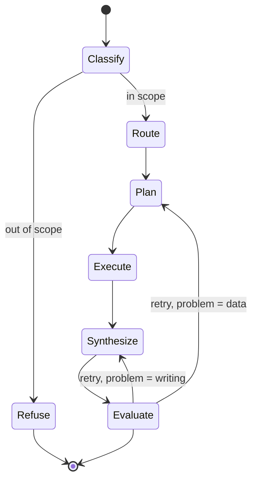

# Serka
Serka (serĉi ekologio) is a prototype search tool for the UKCEH NCUK project. It uses modern AI techniques (LLMs, RAG, knowledge graphs) to enhance the EIDC catalogue's search functionality.

It is built with [FastAPI](https://fastapi.tiangolo.com/), [Neo4j](https://neo4j.com/), [Haystack](https://haystack.deepset.ai/), and [Pydantic AI](https://ai.pydantic.dev/), using Amazon Bedrock for LLM and embedding models.

## AWS Deployment
For AWS deployment instructions see [`terraform/README.md`](terraform/README.md).

## Running with Podman

Ensure you have [`podman`](https://podman.io/) and `podman-compose` installed.

Copy `.env.example` to `.env` and fill in the required values (username must be `neo4j` but password can be set to whatever you choose):
```
NEO4J_USERNAME=neo4j
NEO4J_PASSWORD=<your password>
```

Start all services:
```
podman-compose up -d
```

Stop all services:
```
podman-compose down
```

## Ingest Data

Data is ingested from the EIDC catalogue and optionally the Legilo API. To connect to Legilo, ensure your `.env` contains your credentials:
```
LEGILO_USERNAME=yourusername
LEGILO_PASSWORD=yourpassword
```

After starting all services run the ingestion pipeline:
```bash
uv run scripts/ingest-data.py <n>
```

Where `<n>` is the number of EIDC records to ingest. Ingesting all records (2,000+) can take several hours — use a small number (default: 10) for testing.

To ingest specific datasets instead, pass a file of EIDC IDs (one per line): `uv run scripts/ingest-data.py --ids-file tests/smoke/datasets.txt`.

## Chat Pipeline

`POST /v1/chat/stream` (`{"message": "..."}`) and `POST /v1/chat/stream/agui` (an AG-UI `RunAgentInput` with message history) answer a query with a staged pipeline (`src/serka/chat/`), streamed back as [AG-UI](https://docs.ag-ui.com/) server-sent events.



(Generated with `build_graph().render()` from `serka.chat.pipeline`; edge labels added by hand.)

| Stage | What it does |
|---|---|
| `classify` | One model call decides whether the latest message (read with the conversation history) is in scope and labels it `keyword` (find datasets/entities) or `insight` (a question needing reasoning). |
| `refuse` | Out-of-scope queries get the fixed message "This tool is only able to search the EIDC catalogue and help you find datasets. I'm afraid I cannot help with that request." No tools are called. |
| `route` | Sets the attempt limit: 1 for `keyword`, 3 for `insight`. Emits `RUN_METADATA`. |
| `plan` | `keyword`: derives search parameters (terms, type, location, dates). `insight`: writes a retrieval plan. A `data` retry receives the previous plan and the evaluator's feedback. |
| `execute` | `keyword`: geocodes the location (if any), then calls `search` directly (no model chooses tools). `insight`: an agent with the MCP tools carries out the plan. |
| `synthesize` | Writes the answer from the retrieved data only, citing datasets as `[Exact Title](URI)`. `keyword` answers stream live; `insight` drafts are published as `serka.draft` and the chosen one is sent once at the end. |
| `evaluate` | Scores the answer 1–5 with a problem category. If it fails and attempts remain, loops back to `plan` (`data`) or `synthesize` (`writing`). Otherwise returns the best draft, adding "Note: this answer may be incomplete. The system's quality check wasn't fully satisfied." when the limit is reached. |

### Event contract

Each run streams `RUN_STARTED`, then the events below, and ends with `RUN_FINISHED` (or `RUN_ERROR` with a message if the pipeline fails).

- `RUN_METADATA` (raw SSE event, not an AG-UI type): `{model, models}`. `model` is the answer model (or the classification model for a refusal); `models` maps each stage to its model ID. Always sent before any answer text.
- `STEP_STARTED` / `STEP_FINISHED` with `stepName` `classify`, `route`, `plan`, `execute`, `synthesize`, `evaluate` or `refuse`.
- `TOOL_CALL_START` / `TOOL_CALL_ARGS` / `TOOL_CALL_END` / `TOOL_CALL_RESULT` for every catalogue tool call inside `execute`, sharing one `toolCallId`.
- Exactly one assistant text message (`TEXT_MESSAGE_START`, `TEXT_MESSAGE_CONTENT`..., `TEXT_MESSAGE_END`) holding the final answer.
- `CUSTOM` events:

| Name | Value | When |
|---|---|---|
| `serka.step` | `{step, attempt, maxAttempts, model}` | Right after every `STEP_STARTED`. `model` is null for stages without a model; `maxAttempts` is null before routing. |
| `serka.classification` | `{inScope, label, reason}` | In `classify`. `label` is `keyword`, `insight` or null. |
| `serka.plan` | `{summary, steps}` | In `plan`. |
| `serka.draft` | `{attempt, text}` | In `synthesize`, `insight` queries only. |
| `serka.evaluation` | `{attempt, passed, score, problem, feedback}` | In `evaluate`. `problem` is `none`, `data` or `writing`. |
| `serka.outcome` | `{status, path, attemptsUsed, maxAttempts, score, feedback}` | Immediately before `RUN_FINISHED`. `status` is `accepted`, `limit_reached` or `refused`; `path` is `keyword`, `insight` or null. |

With `TEST_MODE=true` the endpoints replay a scripted keyword run that follows the same contract.

### Models

All chat models run on Amazon Bedrock in `AWS_REGION` (default `eu-west-2`). Each stage's model is set by its own environment variable:

| Variable | Stage | Default |
|---|---|---|
| `MODELS_CLASSIFY` | classify | `amazon.nova-lite-v1:0` |
| `MODELS_PLAN_KEYWORD` | plan (keyword) | `amazon.nova-micro-v1:0` |
| `MODELS_PLAN_INSIGHT` | plan (insight) | `eu.anthropic.claude-sonnet-5-5` |
| `MODELS_EXECUTE_INSIGHT` | execute (insight) | `eu.anthropic.claude-haiku-5-5` |
| `MODELS_SYNTHESIZE_KEYWORD` | synthesize (keyword) | `amazon.nova-lite-v1:0` |
| `MODELS_SYNTHESIZE_INSIGHT` | synthesize (insight) | `eu.anthropic.claude-sonnet-5-5` |
| `MODELS_EVALUATE` | evaluate | `eu.anthropic.claude-haiku-5-5` |

Claude models in `eu-west-2` are reached through EU cross-region inference profiles (`eu.` prefix), and Bedrock model access must be enabled for them. `MODELS_LLM` is no longer used.

## Smoke Test

`uv run scripts/smoke-test.py` runs an end-to-end check. It starts a throwaway Neo4j container on port 17687 and ingests the 10 datasets in `tests/smoke/datasets.txt`. It then starts the MCP server (port 8000) and API (port 19000), runs some search and chat queries, and tears everything down. It needs podman or docker and AWS credentials for Bedrock.

## Contributing

See [CONTRIBUTING.md](CONTRIBUTING.md) for development setup, commit guidelines, and release process.
