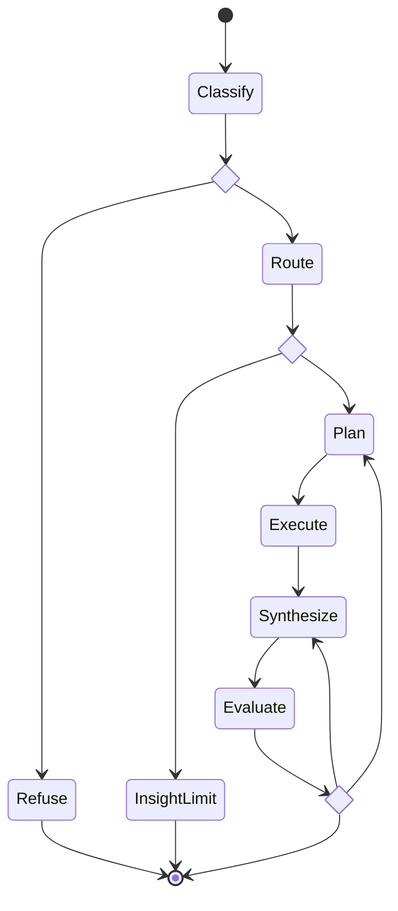

# Serka
Serka (serĉi ekologio) is a prototype search tool for the UKCEH NCUK project. It uses modern AI techniques (LLMs, RAG, knowledge graphs) to enhance the EIDC catalogue's search functionality.

It is built with [FastAPI](https://fastapi.tiangolo.com/), [Neo4j](https://neo4j.com/), [Haystack](https://haystack.deepset.ai/), and [Pydantic AI](https://ai.pydantic.dev/), using Amazon Bedrock for LLM and embedding models.

## AWS Deployment
For AWS deployment instructions see [`terraform/README.md`](terraform/README.md).

## Running with Docker

Ensure you have [Docker](https://docs.docker.com/get-docker/) with the [Compose plugin](https://docs.docker.com/compose/install/) installed.

Copy `.env.example` to `.env` and fill in the required values (username must be `neo4j` but password can be set to whatever you choose):
```
NEO4J_USERNAME=neo4j
NEO4J_PASSWORD=<your password>
```

Start all services:
```
docker compose up -d
```

Stop all services:
```
docker compose down
```

## Ingest Data

Data is ingested from the EIDC catalogue and optionally the Legilo API. To connect to Legilo, ensure your `.env` contains your Legilo personal access token:
```
LEGILO_PAT=yourtoken
```

After starting all services run the ingestion pipeline:
```bash
uv run scripts/ingest-data.py <n>
```

Where `<n>` is the number of EIDC records to ingest. Ingesting all records (2,000+) can take several hours — use a small number (default: 10) for testing.

To ingest specific datasets instead, pass a file of EIDC IDs (one per line): `uv run scripts/ingest-data.py --ids-file tests/smoke/datasets.txt`.

## Chat Pipeline

`POST /v1/chat/stream` (and `/v1/chat/stream/agui`, when chat is enabled) run a [pydantic-graph](https://ai.pydantic.dev/graph/) state machine (`src/serka/chat/pipeline.py`) and stream its progress as [AG-UI](https://docs.ag-ui.com/) events. Each node is a `BaseNode` whose `run()` return type defines its edges:



- **Classify**: refuses out-of-scope queries; labels the rest `keyword` (find datasets) or `insight` (needs reasoning).
- **Route**: allows 1 attempt for `keyword`, 2 for `insight`. An `insight` query over the daily insight cap goes to **InsightLimit**, which ends the run with a fixed message.
- **Plan → Execute**: `keyword` runs a planned `search` directly; `insight` lets a model call MCP tools to follow a plan.
- **Synthesize → Evaluate**: writes a cited answer, then scores it. A failed check retries from Plan (`data` problem) or Synthesize (`writing` problem) while attempts remain; otherwise the best draft is returned, flagged as possibly incomplete.

## Usage Limits

The API is public and unauthenticated, so model-backed runs have hard daily limits, which reset at midnight UTC:

| Setting | Default | Limit |
|---|---|---|
| `USAGE_IP_DAILY_LIMIT` | 30 | Runs per client |
| `USAGE_GLOBAL_DAILY_LIMIT` | 500 | Runs across all clients |
| `USAGE_INSIGHT_DAILY_LIMIT` | 100 | `insight` runs across all clients |

`POST /v1/chat/stream` can return these errors before a run starts. No model is called, and the 422 uses no allowance:

| Status | When | Body `detail` |
|---|---|---|
| 422 | `message` is over 500 characters (also `q` on `/v1/query/semantic`) | Validation error |
| 429 | A client or overall cap is reached; `Retry-After` gives the seconds until the reset | `{code, message}`, where `code` is `client_daily_limit` or `global_daily_limit` |

The insight cap can only apply after classification, so it ends the stream normally with the `insight_limit_reached` outcome. Plain search (`/v1/query/semantic`) is length-limited but not capped. Test mode enforces no daily caps.

Counts are kept in memory by the single API process. They reset at midnight UTC and on restart, so restarts allow extra spending that day, and running several workers would give each its own counts. Client addresses are never written to disk. Behind proxies, set `TRUSTED_PROXY_HOPS` to the number of proxies that append to `X-Forwarded-For`, minus one, because the outermost proxy's entry is the client's address. For example, with an ALB and then an nginx that both append, use 1. Too high a value lets clients choose their identity. The default of 0 ignores the header, so all users behind a proxy share one allowance, and it is the only safe value with a single appending proxy.

`/v1/chat/stream/agui` returns 404 unless `CHAT_ENABLED=true` (default `false`). When enabled, it counts towards the caps and its latest user message has the same 500 character limit. Limits on chat history are required before enabling it in production.

## Smoke Test

`uv run scripts/smoke-test.py` runs an end-to-end check. It starts a throwaway Neo4j container on port 17687 and ingests the 10 datasets in `tests/smoke/datasets.txt`. It then starts the MCP server (port 8000) and API (port 19000), runs some search and chat queries, and tears everything down. It needs Docker and AWS credentials for Bedrock.

## Contributing

See [CONTRIBUTING.md](CONTRIBUTING.md) for development setup, commit guidelines, and release process.
